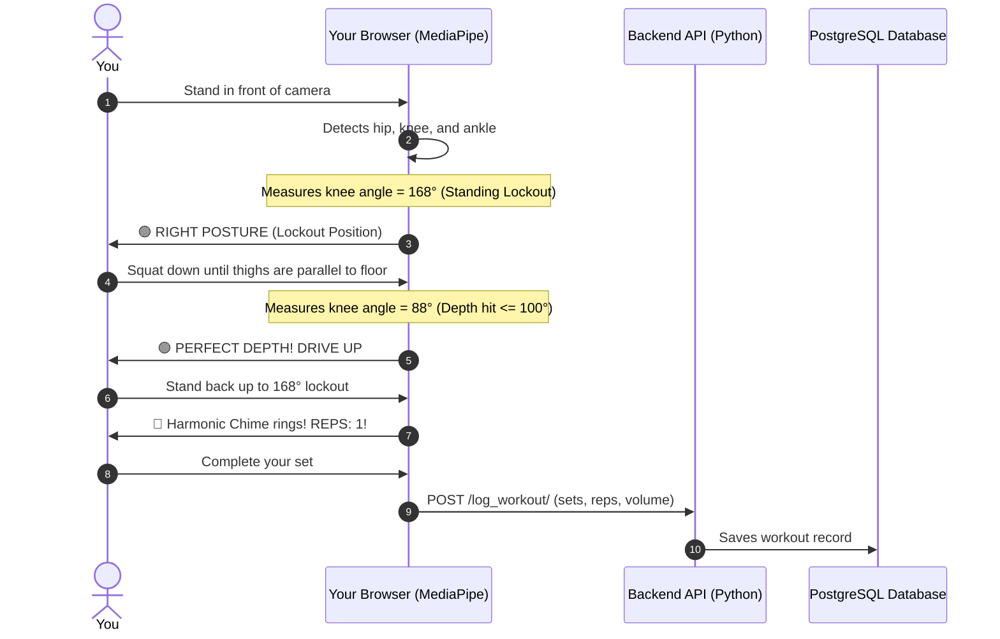
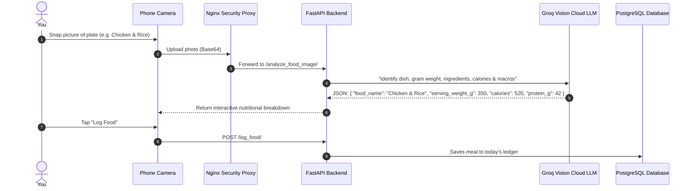

# 🏋️ IronForge AI — Beginner's Architecture Guide
*A Simple, Plain-English Guide to How the Whole System Works*

---

## 🌟 The 30-Second Summary

Imagine **IronForge AI** as a team of 3 specialists working together to give you a personal gym coach directly through your phone or laptop camera:

```
               🧑‍💻 YOU (Athlete in front of camera)
                               │
                               ▼
        ┌──────────────────────────────────────────────┐
        │ 1. THE EYES & THE FACE (Frontend - React)    │
        │ • Shows the buttons and camera viewport      │
        │ • Measures your joints at 60 FPS (MediaPipe) │
        │ • Counts good reps & flags bad posture       │
        └──────────────────────┬───────────────────────┘
                               │ (Sends finished set data)
                               ▼
        ┌──────────────────────────────────────────────┐
        │ 2. THE CHIEF TRAINER (Backend API - FastAPI) │
        │ • Calculates your calories and workout plans │
        │ • Checks user login and passwords            │
        │ • Runs morning cron reminders                │
        └──────────────┬────────────────┬──────────────┘
                       │                │
        ┌──────────────┴───┐        ┌───┴──────────────┐
        ▼                  ▼        ▼                  ▼
┌──────────────────┐ ┌──────────────────┐ ┌──────────────────┐
│ 3. THE MEMORY    │ │ 4. CLOUD VISION  │ │ 5. SPEECH AI     │
│ (PostgreSQL DB)  │ │ (Groq / Llama)   │ │ (Whisper/Deepgram│
│ Remembers your   │ │ Analyzes meal    │ │ Transcribes your │
│ history, reps &  │ │ photos into      │ │ voice commands   │
│ profile settings │ │ grams & calories │ │ hands-free       │
└──────────────────┘ └──────────────────┘ └──────────────────┘
```

---

## 🏛️ Part 1: The Three Main Building Blocks

Every modern web application has three basic layers. Here is how they work in IronForge AI:

### 1. The Frontend (The "Eyes & Face")
* **Technologies Used:** React 18, Vite, Tailwind CSS, Google MediaPipe.
* **Where It Runs:** Directly in your web browser (Chrome, Safari, Edge).
* **Car Analogy:** It’s like the **dashboard, steering wheel, and windshield**—the parts you see and touch.
* **Its Responsibilities:**
  - Displays the user interface (glassmorphic dark mode).
  - Accesses your webcam.
  - Draws glowing cyan bones and yellow degree badges on your joints.
  - Plays harmonic sound chimes when you complete a good repetition.

### 2. The Backend (The "Engine & Chief Trainer")
* **Technologies Used:** Python 3.11, FastAPI, Uvicorn.
* **Where It Runs:** On the server (inside a Docker container on port `8000`).
* **Car Analogy:** It’s like the **engine under the hood**—you don’t see it, but it does all the heavy calculations.
* **Its Responsibilities:**
  - Manages athlete accounts (sign up, login, Google OAuth).
  - Generates customized daily workouts and Indian/Continental diet plans.
  - Analyzes injury reports and swaps out painful exercises for safe alternatives.
  - Schedules automated morning workout notifications.

### 3. The Database (The "Memory Diary")
* **Technologies Used:** PostgreSQL 15 (with SQLite as an offline fallback).
* **Where It Runs:** Inside an isolated Docker container on port `5432`.
* **Car Analogy:** It’s the coach’s **notebook** in the glove compartment.
* **Its Responsibilities:**
  - Safely saves your athlete profile (weight, height, age, fitness goals).
  - Stores your history of logged workouts and scanned meals.
  - Remembers your notifications and custom workout split schedules.

---

## ⚡ Part 2: The Two Kinds of AI (Why It's So Fast)

A big question beginners ask:  
> *"How can the camera track my body at 60 FPS without lag or buffering?"*

The secret is that **IronForge AI divides tasks between two types of AI**:

| Feature | ⚡ Fast Local AI (Edge) | ☁️ Deep Cloud AI (Cloud) |
| :--- | :--- | :--- |
| **Model** | **Google MediaPipe Pose & Hands** | **Qwen 2.5-VL / Llama 3.2 Vision** |
| **Where It Runs** | **100% inside your browser** (Wasm/WebGL) | **High-speed cloud servers** (Groq LPUs) |
| **Speed** | **< 16 milliseconds (60 FPS)** | **~500 ms – 1.0 second** |
| **Privacy** | **Total privacy:** Camera video **never** leaves your device | Single photo sent only when you click "Scan Food" |
| **Primary Tasks** | • Tracking 33 skeletal body points<br>• Real-time joint angle trigonometry<br>• Repetition counting FSM<br>• Hand gesture recognition | • Estimating meal weight in grams<br>• Itemizing ingredients & calorie density<br>• Body fat percentage from silhouettes<br>• Clinical injury rehabilitation advice |

---

## 📖 Part 3: Step-by-Step Stories (How It Works in Action)

### Story 1: How a Squat is Evaluated & Counted



#### What happens if you use BAD posture?
If you lean too far forward during a squat and round your back:
1. The camera measures your torso angle dropping below **$65^\circ$**.
2. The AI immediately marks the rep as **compromised**: `tracker.repFormValid = false`.
3. The viewport pulses **crimson red**: `🔴 WRONG POSTURE: KEEP CHEST UP & SPINE TALL!`.
4. A warning buzzer sounds.
5. When you stand back up, **the rep counter refuses to increment (`❌ NO REP`)** so you cannot cheat your progress or injure your spine!

---

### Story 2: How a Meal Photo is Scanned into Grams & Macros



---

## 🐳 Part 4: What is Docker? (The "Three Lunchboxes")

Normally, setting up a web app with a database and backend on a new computer causes headaches with missing software or version conflicts.

**Docker solves this by packaging the whole project into 3 tidy, self-contained "containers" (like three lunchboxes):**

```
┌────────────────────────────────────────────────────────────────────────┐
│                        DOCKER COMPOSE NETWORK                          │
│                                                                        │
│   🍱 Container 1: ironforge_frontend                                   │
│   • Runs Nginx web server on Ports 80 & 443                            │
│   • Serves the React website & handles secure HTTPS encryption        │
│                               │ (Forwards /api/ calls)                 │
│                               ▼                                        │
│   🍱 Container 2: ironforge_backend                                    │
│   • Runs Python 3.11 & FastAPI on Port 8000                            │
│   • Calculates workouts, validates logins, calls Groq Cloud AI        │
│                               │ (Saves & reads data)                   │
│                               ▼                                        │
│   🍱 Container 3: ironforge_db                                         │
│   • Runs PostgreSQL 15 on Port 5432                                    │
│   • Keeps data permanently safe in a volume called "pgdata"            │
└────────────────────────────────────────────────────────────────────────┘
```

### What is `docker push`?
* When developers finish building their containers, they use **`docker push`** to upload the finished container images to a cloud registry (like Docker Hub or GitHub Packages).
* This way, any production server can simply run **`docker pull`** and start the entire app in seconds without having to build or compile anything from scratch!

---

## 📐 Part 5: Exercise Kinematics Cheat Sheet

How the camera evaluates whether your movement is perfect or flawed:

| Exercise | Monitored Angles | 🟢 Right Posture Thresholds | 🔴 Bad Posture (Triggers `NO REP`) |
| :--- | :--- | :--- | :--- |
| **Squats** | • Knee angle (thigh to calf)<br>• Torso angle (spine to hips) | • Knees bend $\le 100^\circ$ (Parallel)<br>• Torso stays $\ge 68^\circ$ (Chest high) | • Chest collapses forward ($< 65^\circ$)<br>• Half squat reversing before $100^\circ$ |
| **Bicep Curls** | • Elbow flexion<br>• Upper arm flare | • Elbow curls down to $\le 60^\circ$<br>• Upper arm stays pinned $\le 32^\circ$ | • Elbows flare out wide ($> 35^\circ$)<br>• Swinging body momentum |
| **Deadlifts** | • Hip hinge angle<br>• Spine line flatness | • Hips hinge back $\le 112^\circ$<br>• Flat straight spine $\ge 140^\circ$ | • Rounding lower/upper back ($< 140^\circ$)<br>• Shallow hinge without hip travel |
| **Overhead Press** | • Elbow lockout<br>• Lower back arch | • Full vertical overhead reach $\ge 155^\circ$<br>• Neutral spine $\ge 145^\circ$ | • Hyperextending lower back ($< 145^\circ$)<br>• Halfway press lockout ($< 155^\circ$) |
| **Planks** | • Spine line (shoulder–hip–ankle) | • Straight horizontal line ($150^\circ - 180^\circ$) | • Hips sagging downward toward floor<br>• Hips piked high into a tent pyramid |

---

## 📚 Part 6: Beginner's Glossary of Terms

* **Frontend:** The visual interface you see in your browser (React).
* **Backend:** The behind-the-scenes server that processes logic and security (FastAPI).
* **Database:** The persistent storage for user data and workout history (PostgreSQL).
* **MediaPipe:** Google's computer vision library that detects 33 human joint points at 60 FPS directly in the browser.
* **FSM (Finite State Machine):** The 4-step logic cycle (`READY` $\to$ `DESCENT` $\to$ `INFLECTION` $\to$ `ASCENT`) that ensures a repetition is real and not just camera jitter.
* **Docker:** Software that packages the app into isolated containers so it runs identically on any computer.
* **Reverse Proxy (Nginx):** A smart traffic director that receives all incoming web requests, manages SSL/HTTPS security, and forwards them to the correct container.

---

*File generated for athlete reference: `docs/ARCHITECTURE_BEGINNERS_GUIDE.md`*

