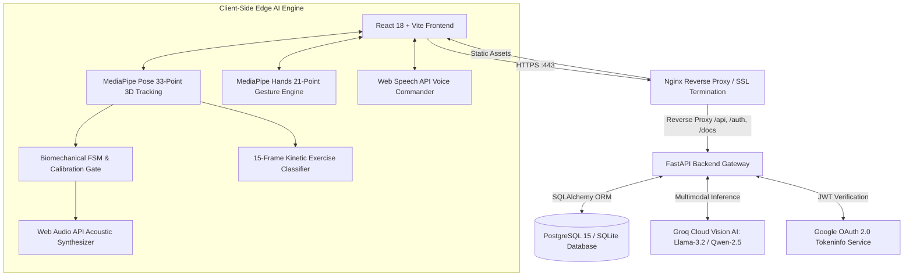

# IronForge AI System Architecture

## 1. High-Level Architecture Overview

IronForge AI is built upon an enterprise **Hybrid Edge/Cloud AI Architecture**. Real-time physical biomechanics run client-side on edge processors with zero latency, while deep multimodal reasoning runs asynchronously on high-parameter cloud neural networks.

---

## 2. Client-Side Edge AI Engine (Browser Layer)

The frontend operates real-time computer vision entirely within the client's browser using Google MediaPipe. Video frames are analyzed locally in canvas buffers and **are never streamed to backend servers**, guaranteeing zero network latency and privacy.

### 2.1 Biomechanical Rep Counting & Calibration Gate
- **Setup Calibration Gate (`READY` Hold):** 
  To eliminate false rep counting from camera jitter, sitting, typing, or posture shifts, the tracker requires holding a clean, locked-out starting posture for $\ge 4$ consecutive frames (~150ms). A repetition **cannot initiate** from mid-air or relaxed sitting.
- **Trigonometric Joint Angle Computation:**
  $$\theta = \left| \operatorname{atan2}(c_y - b_y, c_x - b_x) - \operatorname{atan2}(a_y - b_y, a_x - b_x) \right| \times \frac{180}{\pi}$$
  Angles exceeding $180^\circ$ are reflected ($360^\circ - \theta$).
- **Exponential Moving Average (EMA) Smoothing:**
  $$\hat{\theta}_t = \alpha \cdot \theta_t + (1 - \alpha) \cdot \hat{\theta}_{t-1} \quad (\alpha = 0.35)$$
  Smooths high-frequency sensor noise across frames.
- **Landmark Visibility Filter:** Points with MediaPipe confidence $\le 0.60$ are ignored to prevent phantom angle computations.

### 2.2 Kinetic Multi-Frame Exercise Classifier
When in **Auto-Detect** mode:
1. Evaluates body arrangement (upper body vs lower body visibility, hand elevation relative to shoulders, knee-to-ankle displacement).
2. Maintains a rolling vote buffer of 15 frames:
   - If $\ge 6$ votes agree on an exercise pattern, dynamically sets the active target:
     - **Squat**
     - **Bicep Curl**
     - **Deadlift**
     - **Overhead Press**
     - **Lunges**
3. Synchronizes the UI with a glowing badge: `AI RECOGNIZING: [EXERCISE]`.

### 2.3 Strict 4-Phase Rep Finite State Machine (FSM)
Every counted repetition must satisfy:
1. `READY`: Calibrated lockout held.
2. `ECCENTRIC` / `CONCENTRIC`: Traverses $\ge 40^\circ$ of motion with clean posture.
3. `INFLECTION`: Hits true depth (Squat $\le 100^\circ$, Bicep Curl $\le 56^\circ$, Overhead Press lockout $\ge 158^\circ$, Deadlift hinge $\le 108^\circ$).
4. `RETURN`: Returns completely to lockout.
5. **Quality Gate:** Total rep duration $\ge 1.0\text{ s}$ ($1000\text{ ms}$) and zero form violations. Form violations flag `❌ NO REP` and do not increment the counter.

### 2.4 Acoustic Feedback & Hand Gesture Set Control
- **Web Audio API:** Generates real-time synthesized acoustic tones (587Hz $\to$ 880Hz harmonic ping on successful rep; 220Hz $\to$ 140Hz warning tone on form violation).
- **Debounced Hand Gestures:** Detects raised finger counts using geometric distance vectors between fingertips and wrist base. Requires 10 consecutive frames (~350ms) to trigger a set start.

---

## 3. Backend Gateway Architecture (FastAPI)

The backend provides high-performance, asynchronous RESTful API services:
- **FastAPI Core:** Non-blocking async endpoints utilizing ASGI Uvicorn workers.
- **Database Abstraction:** SQLAlchemy ORM configured with connection pooling. Supports PostgreSQL 15 in production and SQLite in development.
- **Security, Dual-Mode Auth & Credential Management:**
  - Endpoint `POST /google_login/` receives Google JWT tokens (`credential: str`), verified cryptographically against `https://oauth2.googleapis.com/tokeninfo`.
  - Native `POST /login/` supports email and phone number authentication with automatic password linking for OAuth accounts.
  - Endpoint `POST /users/` provisions athlete profiles with duplicate prevention and clean 400 error handling.
  - Endpoint `POST /reset_password/` handles credential recovery and password reset.
- **Cloud Vision Service (`ai_service.py`):**
  - Accepts compressed Base64 images from frontend.
  - Injects structured JSON schemas into Groq system prompts (`qwen/qwen3.8-27b` / `llama-3.2-11b-vision`).
  - Implements multi-model fallback and transient error retry logic with exponential backoff.
  - Computes complete energy density: calories per gram ($\text{kcal/g}$) and per 100g ($\text{kcal/100g}$) for the whole dish and each itemized ingredient.
  - Normalizes full macro and micronutrient arrays (Protein, Carbs, Fats, Dietary Fiber, Sugars, Vitamins, Minerals, Glycemic Index).

---

## 4. Production Web Server & Reverse Proxy (Nginx)

Nginx handles edge traffic on the host:
- Terminates SSL/TLS on port 443 with self-signed or CA-issued certificates.
- Redirects HTTP port 80 traffic to HTTPS port 443.
- Enforces `client_max_body_size 50M` and 120s proxy timeouts to accommodate large 4K smartphone camera vision payloads without 413 entity errors.
- Serves pre-built Vite production assets (`/usr/share/nginx/html`).
- Proxies `/api/`, `/docs`, `/openapi.json`, and auth routes to `http://backend:8000`.
