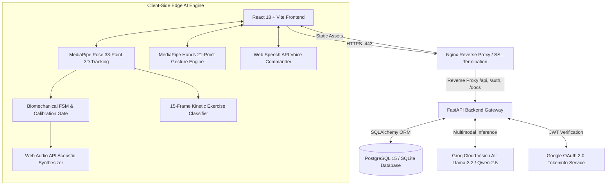

# IronForge AI System Architecture

## 1. High-Level Architecture Overview

IronForge AI is built upon an enterprise **Hybrid Edge/Cloud AI Architecture**. Real-time physical biomechanics run client-side on edge processors with zero latency, while deep multimodal reasoning runs asynchronously on high-parameter cloud neural networks.

---

## 2. Client-Side Edge AI Engine (Browser Layer)

The frontend operates real-time computer vision entirely within the client's browser using Google MediaPipe. Video frames are analyzed locally in canvas buffers and **are never streamed to backend servers**, guaranteeing zero network latency and privacy.

### 2.1 Biomechanical Rep Counting & Calibration Gate
- **Setup Calibration Gate (`READY` Hold):** 
  To eliminate false rep counting from camera jitter, sitting, typing, or posture shifts, the tracker requires holding a clean, locked-out starting posture for $\ge 4$ consecutive frames (~150ms). A repetition **cannot initiate** from mid-air or relaxed sitting.
- **Trigonometric Joint Angle Computation:**
  $$\theta = \left| \operatorname{atan2}(c_y - b_y, c_x - b_x) - \operatorname{atan2}(a_y - b_y, a_x - b_x) \right| \times \frac{180}{\pi}$$
  Angles exceeding $180^\circ$ are reflected ($360^\circ - \theta$).
- **Exponential Moving Average (EMA) Smoothing:**
  $$\hat{\theta}_t = \alpha \cdot \theta_t + (1 - \alpha) \cdot \hat{\theta}_{t-1} \quad (\alpha = 0.35)$$
  Smooths high-frequency sensor noise across frames.
- **Landmark Visibility Filter:** Points with MediaPipe confidence $\le 0.60$ are ignored to prevent phantom angle computations.

### 2.2 Kinetic Multi-Frame Exercise Classifier
When in **Auto-Detect** mode:
1. Evaluates body arrangement (upper body vs lower body visibility, hand elevation relative to shoulders, knee-to-ankle displacement).
2. Maintains a rolling vote buffer of 15 frames:
   - If $\ge 6$ votes agree on an exercise pattern, dynamically sets the active target:
     - **Squat**
     - **Bicep Curl**
     - **Deadlift**
     - **Overhead Press**
     - **Lunges**
3. Synchronizes the UI with a glowing badge: `AI RECOGNIZING: [EXERCISE]`.

### 2.3 Strict 4-Phase Rep Finite State Machine (FSM)
Every counted repetition must satisfy:
1. `READY`: Calibrated lockout held.
2. `ECCENTRIC` / `CONCENTRIC`: Traverses $\ge 40^\circ$ of motion with clean posture.
3. `INFLECTION`: Hits true depth (Squat $\le 100^\circ$, Bicep Curl $\le 56^\circ$, Overhead Press lockout $\ge 158^\circ$, Deadlift hinge $\le 108^\circ$).
4. `RETURN`: Returns completely to lockout.
5. **Quality Gate:** Total rep duration $\ge 1.0\text{ s}$ ($1000\text{ ms}$) and zero form violations. Form violations flag `❌ NO REP` and do not increment the counter.

### 2.4 Acoustic Feedback & Hand Gesture Set Control
- **Web Audio API:** Generates real-time synthesized acoustic tones (587Hz $\to$ 880Hz harmonic ping on successful rep; 220Hz $\to$ 140Hz warning tone on form violation).
- **Debounced Hand Gestures:** Detects raised finger counts using geometric distance vectors between fingertips and wrist base. Requires 10 consecutive frames (~350ms) to trigger a set start (`✌️ 2 Fingers` starts set, `✊ Fist` pauses).

### 2.5 Synchronized Dual-Model Pipeline & Mobile Alternating Scheduler
- **Zero-Flicker Single-Pass Canvas Rendering:** To prevent race conditions where `poseRef.onResults` and `handsRef.onResults` erase each other's canvas buffers with `ctx.clearRect()`, hand landmarks are buffered in `latestHandLandmarksRef`. The unified render loop paints both the full body skeleton and 21-point hand skeletons in a single atomic canvas frame.
- **Mobile Edge Optimization (`modelComplexity: 0`):** Mobile devices dynamically select MediaPipe Lite to fit strictly within mobile browser WebGL memory limits, eliminating frame stutter and WebGL context losses.
- **Alternating Frame Dispatcher:** Dispatches frames to the Pose model on every frame while routing alternating frames (`frameIndex % 2 === 0`) to the Hands model on mobile devices, ensuring fluid 60-FPS rendering without overheating or battery drain.
- **Dual-Layer Hand Skeleton & Fallback:** Renders glowing cyan bones (`#38bdf8`) and yellow fingertip circles (`#facc15`). If hands are partially occluded or too distant for the dedicated hands model, the system seamlessly falls back to Pose wrist, pinky, and index points (`lm[15]`–`lm[22]`).

### 2.6 Glowing Yellow Biomechanical Joint Angle Signals & Dynamic Posture Status
- **Instantaneous Joint Signals (`drawYellowAngleSignal`):** For all active joints (Knees in squats/lunges, Elbows in curls/presses, Hips in deadlifts/crunches):
  - Renders glowing yellow rings (`#facc15`) with a 6px blur directly over anatomical pivots.
  - Draws dynamic yellow circular angle arcs connecting adjacent bone segments.
  - Draws high-contrast yellow pill badges displaying the exact live angle (e.g. `142°`, `88°`).
- **Dedicated Bottom Yellow HUD Strip:** A persistent yellow telemetry bar anchors the camera viewport, streaming real-time biomechanics: `📐 KNEE: ... • ELBOW: ... • HIP: ...` alongside active finger gesture status.
- **Dynamic Posture Indicator:** The top HUD dynamically switches between:
  - `🟢 RIGHT POSTURE`: Verified spinal alignment and proper joint trajectory.
  - `🔴 WRONG POSTURE`: Active form violation with glowing red screen boundary and live audio coaching.
  - `⚪ CALIBRATING FORM`: Hold lockout starting posture.

### 2.7 Floor & Abs Workout Biomechanics Suite
Specialized kinematic modules for horizontal and floor training:
- **Crunches:** Measures hip-to-shoulder angle excursion; counts reps when torso elevates past $35^\circ$ inflection and returns to floor.
- **Plank Hold:** Continuously verifies straight-line alignment between shoulders, hips, and ankles ($165^\circ$–$180^\circ$); increments an active hold stopwatch while posture is valid and pauses timer if hips sag or hike.
- **Leg Raises:** Tracks hip-to-ankle elevation angle from $15^\circ$ up to $75^\circ$ with controlled descent.

---

## 3. Backend Gateway Architecture (FastAPI)

The backend provides high-performance, asynchronous RESTful API services:
- **FastAPI Core:** Non-blocking async endpoints utilizing ASGI Uvicorn workers.
- **Database Abstraction:** SQLAlchemy ORM configured with connection pooling. Supports PostgreSQL 15 in production and SQLite in development.
- **Security, Dual-Mode Auth & Credential Management:**
  - Endpoint `POST /google_login/` receives Google JWT tokens (`credential: str`), verified cryptographically against `https://oauth2.googleapis.com/tokeninfo`.
  - Native `POST /login/` supports email and phone number authentication with automatic password linking for OAuth accounts.
  - Endpoint `POST /users/` provisions athlete profiles with duplicate prevention and clean 400 error handling.
- **Notification & Delivery Preferences Engine (`scheduler.py` & `main.py`):**
  - Schema includes `email_notifications_enabled` (`"true"` vs `"false"`), auto-migrated via SQL table inspection.
  - Endpoint `PUT /users/{user_id}/notification_preferences` allows immediate toggling without full profile mutation.
  - Background cron scheduler checks `user.email_notifications_enabled != "false"` before initiating SMTP connections via `email_service.send_email`.
  - In-app notification records (`models.Notification`) are **always committed** to the database ledger (`channel="app"`), guaranteeing that athletes who prefer checking their routines within the app have uninterrupted access via the in-app notification center.

  - Accepts compressed Base64 images from frontend webcam or file uploads.
  - Injects structured JSON schemas into Groq system prompts (`qwen/qwen3.8-27b` / `llama-3.2-11b-vision`).
  - Implements multi-model fallback and transient error retry logic with exponential backoff.
  - Computes complete energy density: calories per gram ($\text{kcal/g}$) and per 100g ($\text{kcal/100g}$) for the whole dish and each itemized ingredient.
  - Normalizes full macro and micronutrient arrays (Protein, Carbs, Fats, Dietary Fiber, Sugars, Vitamins, Minerals, Glycemic Index).

### 3.1 Scientific Analysis of Food Weight Estimation from 2D Photos
1. **The Physical Limitation of Single-View 2D Photography:**
   Estimating physical mass solely from a single RGB 2D photo has inherent physical constraints:
   - **Lack of Volumetric Depth ($Z$-axis):** A 2D image records pixels on an $(X, Y)$ plane. A 150g portion and a 300g portion can appear identical in surface area depending on distance to the lens or portion depth.
   - **Density Variance ($\text{Mass} = \text{Volume} \times \text{Density}$):** Two foods of identical volume have vastly different densities (e.g., whipped Greek yogurt vs. dense peanut butter).
   - **Occluded & Sub-Surface Layers:** Complex dishes (curries, burritos, salads, bowls) have ingredients and calorie-dense cooking oils concealed beneath top layers.
2. **Role of Pretrained Vision Models:**
   Vision models excel at **semantic component identification** and determining intrinsic **caloric and macronutrient density** ($\text{kcal/g}$, protein %, carb %, fat %) based on comprehensive nutritional data. However, their portion weight estimate in grams is an empirical heuristic.
3. **The Hybrid Solution (Computer Vision + User Calibration):**
   - The AI identifies all ingredients, classifies the dish, and calculates baseline nutrient densities ($\text{kcal/g}$).
   - The athlete inputs or adjusts the ground-truth scale weight (e.g., actual kitchen scale reading in grams).
   - The frontend recalculates all calories, protein, carbs, fats, fiber, and sugars dynamically based on the verified weight, delivering scientific precision.

---

## 4. Production Web Server & Reverse Proxy (Nginx)

Nginx handles edge traffic on the host:
- Terminates SSL/TLS on port 443 with self-signed or CA-issued certificates.
- Redirects HTTP port 80 traffic to HTTPS port 443.
- Enforces `client_max_body_size 50M` and 120s proxy timeouts to accommodate large 4K smartphone camera vision payloads without 413 entity errors.
- Serves pre-built Vite production assets (`/usr/share/nginx/html`).
- Proxies `/api/`, `/docs`, `/openapi.json`, and auth routes to `http://backend:8000`.
