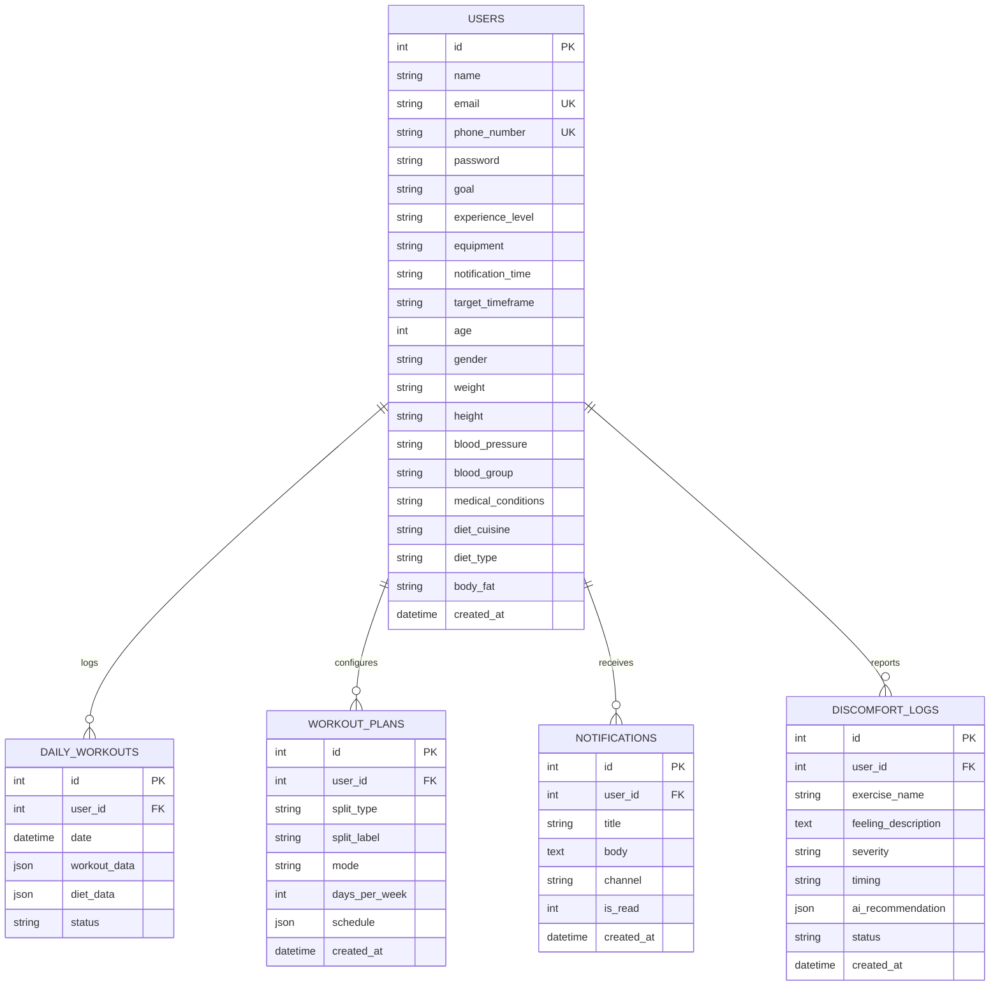

# Database Architecture & Entity Design

IronForge AI utilizes an enterprise relational schema managed via SQLAlchemy ORM. The platform supports a dual-engine persistence layer:
- **Production:** PostgreSQL 15 running in the `ironforge_db` Docker container with persistent volumes (`pgdata`).
- **Development:** SQLite (`fitness_tracker.db`) for zero-configuration local experimentation.

---

## 🗄️ Entity-Relationship Model (ERD)



---

## 📋 Table Definitions

### 1. `users` Table
Stores athlete identity credentials, physiological attributes, medical history, and nutrition preferences.

| Column | Type | Constraints | Description |
| :--- | :--- | :--- | :--- |
| `id` | Integer | Primary Key, Indexed | Unique user identifier |
| `name` | String | Indexed | Full name |
| `email` | String | Unique, Indexed | Primary login & Google OAuth identifier |
| `phone_number` | String | Unique, Indexed | Optional SMS contact number |
| `password` | String | Nullable | Encrypted password (optional for Google sign-in) |
| `goal` | String | Nullable | e.g., 'Build Muscle', 'Lose Fat', 'Athletic Conditioning' |
| `experience_level`| String | Nullable | 'Beginner', 'Intermediate', 'Advanced' |
| `equipment` | String | Nullable | 'Full Gym', 'Dumbbells Only', 'Bodyweight' |
| `age`, `gender` | Int / String | Nullable | Physiological stats |
| `weight`, `height`| String | Nullable | Mass and stature measurements |
| `blood_pressure` | String | Nullable | Clinical safety metric |
| `diet_cuisine` | String | Default: 'Generic Indian'| Cuisine preference driving AI meal plans |
| `diet_type` | String | Default: 'No Preference'| Dietary restriction (Vegan, Vegetarian, Keto, etc.) |
| `created_at` | DateTime | Default: UTC Now | Account creation timestamp |

---

### 2. `daily_workouts` Table
Tracks daily physical warfare and nutritional consumption.

| Column | Type | Description |
| :--- | :--- | :--- |
| `id` | Integer | Primary Key |
| `user_id` | Integer | Foreign Key $\to$ `users.id` |
| `date` | DateTime | Date of workout and nutrition entries |
| `workout_data` | JSON | AI-generated and completed exercises, sets, reps, and form scores |
| `diet_data` | JSON | Complete nutritional log including gram-weight, macros, and itemized ingredients |
| `status` | String | 'pending', 'completed' |

#### Schema for `diet_data` JSON:
```json
{
  "food_name": "Grilled Chicken Rice Bowl",
  "serving_weight_g": 420,
  "calories": 580,
  "macros": {
    "protein_g": 48.0,
    "carbs_g": 62.0,
    "fats_g": 12.0
  },
  "ingredients": [
    {
      "name": "Chicken Breast",
      "weight_g": 200,
      "calories": 330,
      "protein_g": 42.0,
      "carbs_g": 0.0,
      "fats_g": 4.0
    },
    {
      "name": "Steamed White Rice",
      "weight_g": 180,
      "calories": 210,
      "protein_g": 4.5,
      "carbs_g": 56.0,
      "fats_g": 0.5
    }
  ],
  "scientific_notes": "Lean protein source paired with high-glycemic carbohydrates optimal for post-workout glycogen resynthesis."
}
```

#### Schema for `workout_data` JSON:
```json
{
  "routine_title": "Legs & Core Biomechanical Session",
  "exercises": [
    {
      "name": "Barbell Squats",
      "target_sets": 3,
      "completed_sets": 3,
      "reps_per_set": [12, 10, 10],
      "posture_quality": "RIGHT",
      "form_score_percentage": 94,
      "joint_metrics": { "min_knee_angle_deg": 88, "torso_incline_deg": 74 }
    },
    {
      "name": "Plank Core Hold",
      "target_sets": 3,
      "completed_sets": 3,
      "hold_duration_seconds": 60,
      "posture_quality": "RIGHT",
      "form_score_percentage": 98,
      "joint_metrics": { "body_alignment_deg": 174 }
    }
  ]
}
```

---

### 3. `workout_plans` Table
Houses the athlete's customized training split and weekly muscle allocation.

| Column | Type | Description |
| :--- | :--- | :--- |
| `id` | Integer | Primary Key |
| `user_id` | Integer | Foreign Key $\to$ `users.id` |
| `split_type` | String | 'ppl', 'arnold', 'upper_lower', 'full_body', 'custom' |
| `days_per_week` | Integer | Weekly training frequency (e.g., 3, 4, 5, 6) |
| `schedule` | JSON | Mapping of days to muscle groups: `{ "Monday": ["Chest", "Triceps"], ... }` |

---

### 4. `discomfort_logs` Table
Maintains injury records and AI Doctor/Physical Trainer adaptation profiles.

| Column | Type | Description |
| :--- | :--- | :--- |
| `id` | Integer | Primary Key |
| `user_id` | Integer | Foreign Key $\to$ `users.id` |
| `exercise_name` | String | Exercise triggering pain (e.g., 'Barbell Bench Press') |
| `feeling_description`| Text | Athlete's subjective symptom report |
| `severity` | String | 'Mild', 'Moderate', 'Severe' |
| `timing` | String | 'During exercise', 'Post set', 'Post workout' |
| `ai_recommendation` | JSON | Doctor diagnosis, physical therapy advice, and non-injurious exercise substitutions |
| `status` | String | 'active', 'resolved' |

---

### 5. `notifications` Table
Zero-key in-app notification center for motivation, streak reminders, and workout callouts.
