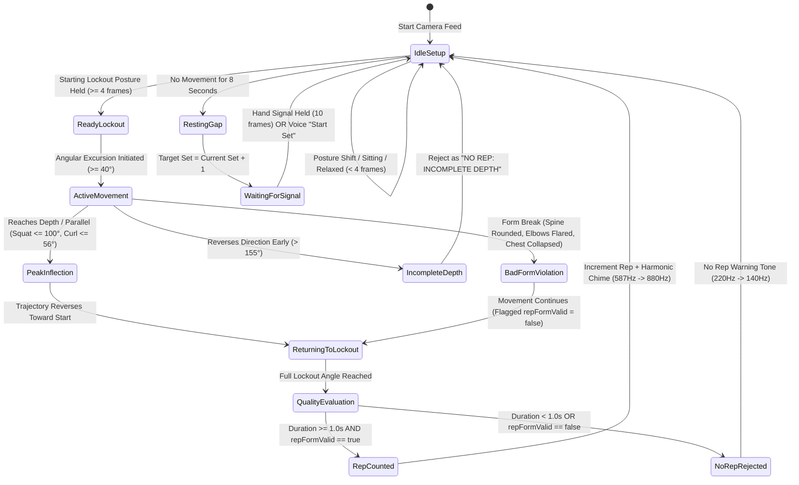
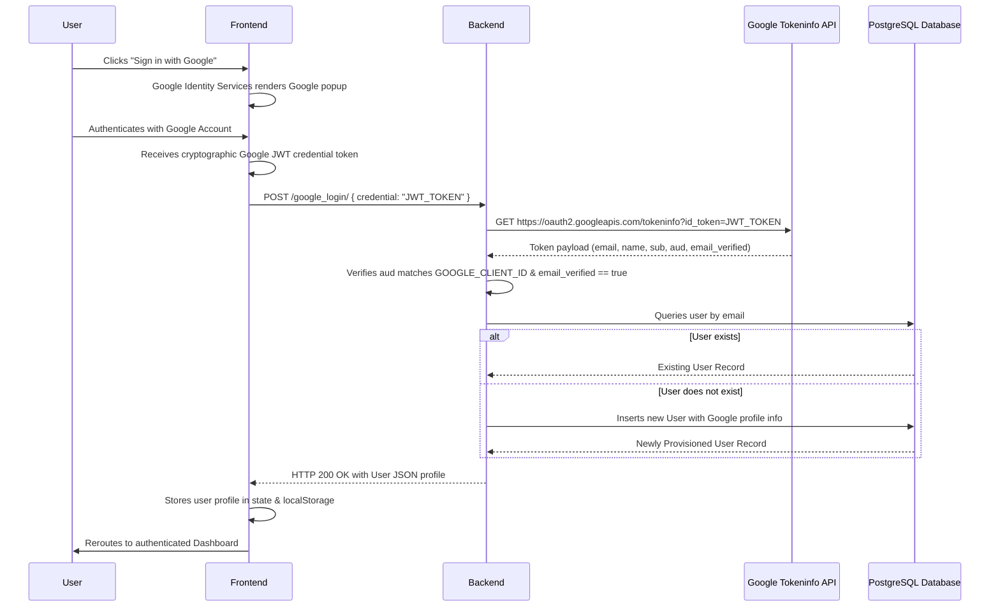
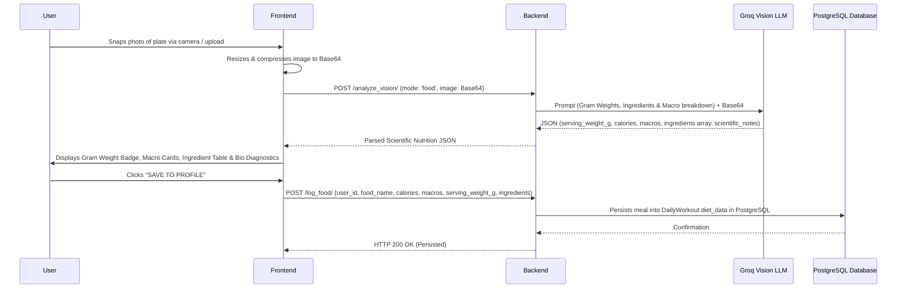

# Logical Flows & State Machines

## 1. AI Form Coach - Biomechanical Repetition State Machine

The AI Form Coach operates on a strict multi-stage finite state machine (FSM) designed to prevent false rep counts caused by posture shifts, sitting down, typing, camera jitter, or finger movements.

---

### 1.1 Starting Posture Calibration Gate (`READY` Hold)
Before any repetition can begin:
1. MediaPipe Pose must detect all relevant landmarks with confidence score $> 0.60$.
2. The user must hold the **locked-out starting posture** for at least **4 consecutive frames (~150ms)**:
   - **Squats:** `kneeAngle > 160°` AND `torsoAngle >= 70°`.
   - **Bicep Curls:** `elbowAngle > 148°` AND `upperArmAngle <= 30°` (elbow pinned to ribs).
   - **Deadlifts:** `hipAngle > 165°` AND `spineAngle >= 145°`.
   - **Overhead Press:** `elbowAngle < 85°` with wrists at shoulder rack height AND `spineAngle >= 148°`.
   - **Lunges:** Both knees locked upright (`kneeAngle > 160°`).
3. If this condition is not met (e.g. the user is seated in a chair, typing, or moving around), the tracker remains in `IDLE` and **cannot initiate a repetition**.

---

### 1.2 Kinetic Multi-Frame Exercise Auto-Classifier
When in **Auto-Detect** mode:
1. MediaPipe analyzes active limb arrangement:
   - Upper body only in frame $\to$ checks for Overhead Press (wrists above head) or Bicep Curl (pinned elbows).
   - Full body in frame $\to$ checks for Lunges (asymmetrical knee height), Deadlifts (deep hip hinge with soft knees), or Squats (deep synchronous knee flexion).
2. Pushes classification candidate into a 15-frame rolling buffer.
3. When $\ge 6$ frames agree on an exercise, updates `activeExercise` and synchronizes the UI badge: `AI RECOGNIZING: [EXERCISE]`.

---

### 1.3 Debounced Hand Gesture Signal Flow
1. When between sets or in rest mode, the tracker enters `WaitingForSignal` state with `waitingForSignal = Math.min(setCount, 5)`.
2. MediaPipe Hands calculates distance from wrist (landmark 0) to fingertips (landmarks 8, 12, 16, 20) and pinky base to thumb (landmark 4) to count raised fingers.
3. If `detected_fingers === waitingForSignal` for **10 consecutive frames (~350ms)**, the set unlocks (`waitingForSignal = 0`) and transitions to `IDLE` setup.
4. Hand tracking is **completely isolated from repetition counting** and never increments reps.

---

## 2. Hardened Google OAuth 2.0 Authentication Flow

---

## 3. Scientific Auto-Food Logger Flow

